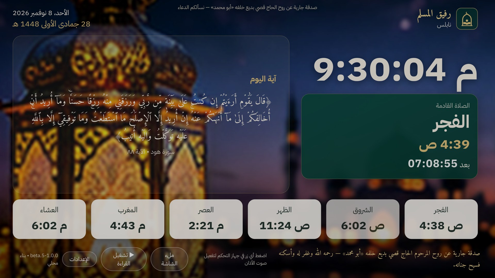

# رفيق المسلم TV بريميوم — تقرير المرحلة الأولى

نسخة مستقلة جديدة لشاشة Android TV بمعرّف `org.rafiqalmuslim.tv.premium`، مبنية من الكود نفسه مع النسخة
الجديدة `org.rafiqalmuslim.tv.next`. النسخة الجديدة لم تتغير وظيفيًا: مزايا بريميوم لا تظهر إلا في نسختها،
واختبار آلي يتحقق من ذلك. لم تُحذف النسخ السابقة ولم تُعدَّل.



## 1. التدقيق: ما وُجد في المشروع

| الجزء | الملفات | ما يفعله |
|---|---|---|
| جسر Android | `android-tv/.../TvWeb.java` (الكائنات `RafiqTV` و`RafiqPhotos` و`RafiqVoice`) | الإعدادات الأصلية، والتشغيل التلقائي، ووضع الشاشة الرئيسية، والتطبيقات، والاقتران، والصور، والكلام الآلي |
| الواجهة | `src/tv/*.tsx` و`tv.css`، تُبنى بـ `npm run build:tv` إلى أصول التطبيق | الساعة والمواقيت، والأذان والإقامة، والتلاوة، والمشاهد، والإعدادات |
| الخلفية وعدم الاستخدام | `TvService` و`IdleWatcher` (خدمة إتاحة) و`IdleRules` (منطق مختبر) و`Alarms` و`BootReceiver` و`PrayerDream` | فتح الشاشة عند عدم الاستخدام ومن الشاشة الرئيسية فقط، لا فوق يوتيوب أو HDMI؛ والأذان فوق التطبيقات بشريط |
| الاقتران | `RemoteCore` (رمز 6 أرقام لا يُرسل، ومفتاح مشتق، وتوقيع HMAC لكل طلب) و`RemoteServer` و`RemoteHttp` | التحكم من تطبيق الجوال على الشبكة المنزلية |
| الأذان والتلاوة | `TvApp` (الأذان) و`useRecitation` و`recite.ts` و`AdhanActivity` | تلاوة متصلة بتحميل مسبق، واستئناف من آخر موضع، وتوقف وقت الأذان |
| الحفظ | `localStorage` للمفتاح `rafiq-tv:settings`، و`SharedPreferences` للمفتاح `rafiq_tv` | إعدادات الشاشة، وموضع التلاوة، والإعدادات الأصلية |
| الصور | `gallery.ts` و`PhotoScene` و`Backgrounds.java` و`tv-photos/` (86 صورة بدقة 1280×720) | الصور الجاهزة، وصور الجوال بتلاشٍ، والمشاهد المرسومة |

## 2. ما أُنجز (مختبر في متصفح حقيقي)

**النسخة المستقلة:**
- نكهتا Gradle من الكود نفسه: `next` و`premium`.
- تطبيق بريميوم يفتح الواجهة بالرابط `?ed=premium`، ويحمل اسمًا مختلفًا: «رفيق المسلم TV بريميوم».
- يبني CI النسختين، ويتحقق من توقيعهما، وينشر `RafiqAlMuslimTVPremium.apk` بجانب الملفات الحالية.

**جداول العرض الذكية:** صفحة «🗓 جداول العرض».
- **أنواع الجداول:**
  - بالساعات، ومنها ما يعبر منتصف الليل؛
  - حول وقت صلاة معينة أو كل الصلوات، بدقائق قبلها وبعدها؛
  - الليل، من العشاء حتى الفجر؛
  - أيام الأسبوع؛
  - المناسبات من التاريخ الهجري: رمضان، والعيدان، وأيام الحج، والعشر الأوائل، وعاشوراء، والجمعة.
- **الأولوية:** يُقدَّم الأخص، أي المناسبة ثم الصلاة ثم الليل ثم الأيام ثم الساعات.
- **ما يمكن عرضه:** أي مشهد مرسوم موجود، أو الصور الجاهزة بتصنيفها، أو صور الجوال.
- **الانتقال:** تلاشٍ ناعم، أو تلاشٍ مع اقتراب، أو بلا انتقال، بمدة من 1 إلى 8 ثوانٍ.

**حماية الشاشة (OLED):** صفحة «🛡 حماية الشاشة».
- إزاحة العناصر الثابتة على 9 مواضع صغيرة كل دقيقتين، بانتقال بطيء غير ملحوظ.
- تبديل مكان الساعة والبطاقة كل ساعة.
- تخفيض الإضاءة من بعد العشاء بنصف ساعة حتى قبل الفجر بنصف ساعة، بأربع درجات. لا يُعتَّم وقت الأذان.
- وضع اقتصادي يوقف الحركة ويخفض جودة الرسم.

**التلاوة:** دون حذف أي قارئ أو محتوى.
- قراء مفضلون (★) يظهرون أول القائمة.
- قائمة تشغيل سور تدور بالترتيب.
- سرعة التلاوة ×0.75 و×1 و×1.25 و×1.5.
- **موجود من قبل وأبقيته:** الاستئناف من آخر موضع، وعرض الآية الحالية واسم السورة والقارئ، وأزرار الوسائط في جهاز التحكم.

**إهداء صدقة جارية:** أُضيف ثم أُلغي بطلب صاحب التطبيق. يبقى سطر الصدقة الجارية الأصلي في التطبيق كما هو.

**تحسينات الواجهة:**
- قائمة الإعدادات صارت قابلة للتمرير، وزر الحفظ ظاهر دائمًا. كانت الأقسام الإضافية تخرج عن الشاشة، واكتشف ذلك الاختبار الآلي.
- النصوص الطويلة (آية اليوم الطويلة أو حديث) تصغر لتظهر كاملة بدل قصّ آخرها. هذا الإصلاح في النسختين.

## 3. الاختبارات ونتائجها

| الاختبار | الطريقة | النتيجة |
|---|---|---|
| منطق الجداول والمناسبات والإزاحة والتعتيم وقائمة السور وتصحيح الإعدادات الخاطئة | اختبارات وحدة (`src/tv/premium.test.ts`، 12 اختبارًا) | ناجح |
| كل اختبارات الوحدة في المشروع | `npx vitest run` | ناجح (383) |
| النسخة الجديدة لا تتغير: بلا صفحات بريميوم، ويتجاهل جداول محفوظة | متصفح حقيقي (`e2e-tv/premium.spec.ts`) | ناجح |
| الجداول: الليل يعرض مشهده، والنهار يعود، والجمعة تتقدم على الساعات، مع انتقال التلاشي | متصفح حقيقي بساعة مضبوطة | ناجح |
| حماية الشاشة: الإزاحة، والتعتيم ليلًا وزواله نهارًا | متصفح حقيقي | ناجح |
| الإعدادات بالأزرار: إضافة جدول، وتعتيم، ومفضل، وسرعة، وقائمة سور، والحفظ | متصفح حقيقي | ناجح |
| سرعة التلاوة على ملف الآية، وعرض الآية والسورة، وانتقال القائمة من الإخلاص إلى الفاتحة | متصفح حقيقي بصوت محلي | ناجح |
| عرض بدقة 3840×2160 | لقطة في المتصفح | ناجح (الصورة أعلاه) |
| بناء النسختين وتوقيعهما واختبارات Java (`IdleRulesTest` و`RemoteCoreTest`) | GitHub Actions | ناجح |
| على تلفاز Android حقيقي: التشغيل وإعادة التشغيل، والاستعداد، وعدم الاستخدام، وHDMI، والفيديو والصوت، وانقطاع الإنترنت، والاقتران والفصل، والذاكرة والمعالج، وOLED الفعلي، والريموت | — | **لم يُختبر**: لا يوجد جهاز Android TV في بيئة التطوير |

لم أغيّر منطق عدم الاستخدام وHDMI، ومنه ألّا تُفتح الشاشة فوق يوتيوب أو الألعاب أو HDMI. اختباراته الموجودة (`IdleRulesTest`) ما زالت تنجح.

## 4. ما لم يكتمل ولماذا

1. **مكتبة خلفيات 4K وفيديوهات سينمائية:**
   - لا أُنشئ صورًا بنفسي، بناءً على طلب صاحب التطبيق السابق.
   - لا توجد صور 4K أو فيديوهات مرخّصة جاهزة في المشروع.
   - الصور الحالية 1280×720، وإضافة مكتبة 4K داخل ملف التطبيق تكبّره كثيرًا.
   - **المطلوب:** صور وفيديوهات أصلية من صاحب التطبيق، أو مصدر مرخّص للاستخدام التجاري مع مفتاح API. بعدها تُبنى حزم تُنزَّل حسب قوة الجهاز.
2. **استوديو التحكم من الجوال:** أُنجز في المرحلة الثانية (القسم 5). لم يُختبر بين جوال وتلفاز حقيقيين بعد.
3. **تنزيل التلاوات للعمل دون إنترنت على التلفاز:** لم يُنفذ. يحتاج تخزينًا أصليًا في Android ومراقبة المساحة على أجهزة التلفاز محدودة الذاكرة.
4. **التحكم بسرعة التلاوة ومستوى الصوت من الجوال:** يُضبطان من التلفاز فقط.
5. **مراجعة شاملة للنصوص الشرعية:**
   - لم تُعدَّل أي نصوص، ولم يُضف حديث أو ذكر.
   - النصوص الحالية مأخوذة من مصادر التطبيق الموثقة، أي كتاب حصن المسلم ومكتبة الحديث بتخريجها.
   - المراجعة الشرعية الكاملة تحتاج مختصًا.
6. **شرح الأذونات:** بقي كما هو في صفحة «⚡ التشغيل التلقائي». فيها خطوات خدمة الإتاحة، والظهور فوق التطبيقات، والتشغيل عند الإقلاع، وحالة كل منها.
7. **تثبيت النسختين معًا على تلفاز واحد:** غير منصوح به. كل منهما تشغّل خدمة الخلفية وخادم الاقتران نفسيهما، فثبّت إحداهما فقط.

## 5. المرحلة الثانية: استوديو التحكم من الجوال ورمز QR

**في الجوال** («التحكم بالتلفاز»، لتلفاز عليه نسخة بريميوم):
- **معاينة حية بنسبة 16:9:** تتغير فورًا مع كل اختيار. ومعها زر «لقطة من التلفاز» يعرض صورة حقيقية مصغرة من الشاشة الظاهرة.
- **الأحجام:** الساعة والصلاة القادمة، وشريط المواقيت، ونص البطاقة، من 80٪ إلى 140٪.
- **الأماكن:** الساعة يمينًا أو يسارًا، والمواقيت أسفل أو أعلى أو مخفية، والبطاقة ظاهرة أو الساعة وحدها.
- **الخط والألوان:** خمسة خطوط (عصري، وأميري، ونسخ، وكوفي، ورقعة)، وستة ألوان مميزة، وثلاثة ألوان للكتابة.
- **الخلفيات وإرسال الصور:** كما كانت في الصفحة نفسها.
- **«تصاميمي»:** حفظ التصميم مع المشهد باسم، ثم تطبيقه على هذا التلفاز أو على كل التلفزيونات المرتبطة. عدة تلفزيونات كانت مدعومة من قبل، وصار التصميم يُطبَّق عليها كلها.
- **الربط برمز QR:** بالكاميرا، أو من صورة للرمز. يُربط الجوال مباشرة دون كتابة الرمز ولا البحث عن العنوان، وتبقى طريقة الرمز المكتوب كما هي.

**في التلفاز (بريميوم):**
- **رمز QR بجانب أرقام الربط:** يحمل العنوان والمنفذ والرمز. الرمز ظاهر على الشاشة أصلًا، ويُشتق منه مفتاح التشفير على الجهازين دون أن يُرسل.
- **تطبيق إعدادات الاستوديو.** النسخة الجديدة تتجاهلها.
- **طلب موقّع `GET /screen`:** يعيد لقطة JPEG بعرض 640 من الشاشة الظاهرة.
- **التحقق من القيم:** يقبل `RemoteCore` قيم الاستوديو من قائمة ثابتة فقط، فلا يُقبل لون أو خط أو حجم خارجها ولا أي نص CSS.
- **الأمان:** الجوال لا يقبل من رمز QR إلا عنوانًا من الشبكة المنزلية ومنفذًا صحيحًا ورمزًا من 6 أرقام.

**الاختبارات:**

| الاختبار | النتيجة |
|---|---|
| رمز QR على التلفاز ← قراءته بمكتبة الجوال (`jsqr`) ← العنوان والمنفذ والرمز نفسها، ورفض العناوين الخارجية والرموز الخاطئة | ناجح (اختبارات وحدة) |
| QR الظاهر فعلًا في صفحة الربط على التلفاز يُقرأ ويعطي البيانات الصحيحة، والنسخة الجديدة بلا QR | ناجح (متصفح حقيقي) |
| الاستوديو على التلفاز: ساعة 140٪، والمواقيت أعلى، والبطاقة مخفية، واللون والخط والجهة؛ والنسخة الجديدة تتجاهله؛ ولقطة الإعدادات للجوال فيها الاستوديو | ناجح (متصفح حقيقي) |
| `RemoteCore`: قبول قيم الاستوديو الصحيحة ورفض غيرها، و`/screen` يحتاج توقيعًا، والنسخة الجديدة تعيد `not_supported` | اختبارات Java في CI |
| الجوال: المعاينة تعكس الأماكن والأحجام والخط، وكل اختيار يُرسل الاستوديو كاملًا، واللقطة تظهر، والتصاميم تُحفظ وتُطبَّق على تلفاز واحد وعلى الكل وتُحذف | ناجح (اختبارات مكونات) |
| الكاميرا الحقيقية في الجوال، واللقطة الحقيقية من WebView التلفاز، والربط بين جهازين على شبكة البيت | **لم يُختبر**: لا جوال ولا تلفاز حقيقي في بيئة التطوير |

**ملاحظة:** اللقطة تُرسم من WebView. على بعض الأجهزة قد تظهر المشاهد المتحركة المرسومة على Canvas سوداء فيها، أما النصوص والمواقيت والصور فتظهر.

## 6. البناء والتحديث

```bash
npm ci
npm run build:tv && npm run tv:assets          # واجهة الشاشة إلى أصول التطبيق
cd android-tv && ./gradlew assembleNextDebug   # النسخة الجديدة: org.rafiqalmuslim.tv.next
cd android-tv && ./gradlew assemblePremiumDebug  # بريميوم: org.rafiqalmuslim.tv.premium
npm run test:tv                                 # اختبارات شاشة التلفاز في متصفح حقيقي
npx vitest run                                  # اختبارات الوحدة
```

- **الإصدار التجريبي:** من GitHub Actions بالخيار `publish_beta`. يُنشر `RafiqAlMuslimTVPremium.apk` في إصدار `new-…` بجانب ملفي الهاتف والتلفاز.
- **التوقيع:** مفتاح النسخ التجريبية نفسه، فتُثبَّت كل نسخة بريميوم فوق السابقة.
- **التحديث من الجوال (`Updater`):** يقبل ملفًا للتطبيق نفسه فقط، فلا يستبدل النسخة الجديدة بنسخة بريميوم ولا العكس.
- **ملفات هذه المرحلة:**
  - `src/tv/premium.ts` و`src/tv/PremiumPages.tsx` و`src/tv/controls.tsx`؛
  - `e2e-tv/` و`playwright.tv.config.ts`؛
  - `android-tv/app/build.gradle` (النكهات) و`android-tv/app/src/premium/`.
